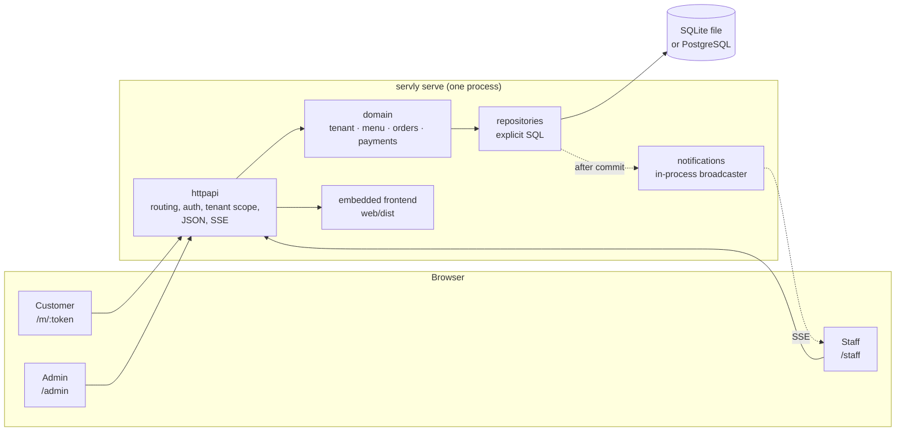

servly is a modular monolith: one Go process that serves the JSON API, the live order events and the web frontend. The modules mark business boundaries. They are not separately deployed services. The authoritative specification is [`MASTER_PLAN.md`](https://github.com/servly-io/servly/blob/main/MASTER_PLAN.md); this page describes how the code implements it.

## Process

* **Local profile:** SQLite in the data directory. No other service is needed, and no network beyond the restaurant LAN.
* **Managed cloud profile:** PostgreSQL. The same binary runs with `SERVLY_DATABASE_DRIVER=postgres`.

## Packages

| Package | Owns | May import |
|---|---|---|
| `cmd/servly` | `main`; embeds tzdata | `internal/cli` |
| `internal/cli` | cobra commands `serve`, `migrate`, `config`, `version`; wiring | everything |
| `internal/platform/config` | configuration from flags, env and file (viper) | - |
| `internal/platform/database` | open SQLite/PostgreSQL, migrations, `InTx`, `Timestamp` | `migrations` |
| `internal/platform/database/dbtest` | fresh migrated databases for tests, per dialect | `database` |
| `internal/platform/logging` | `slog` setup | - |
| `internal/apperr` | client-safe error vocabulary (kind + code) | - |
| `internal/ids` | UUIDv7 ids, public tokens | - |
| `internal/money` | `Amount` (minor units), `Currency`, checked arithmetic | `apperr` |
| `internal/tenant` | tenants, users, memberships, roles and permissions, locations, domains | `money`, `database` (types only) |
| `internal/menu` | categories, items, option groups, options | `money`, `apperr` |
| `internal/orders` | orders, lines, status machine, idempotency contract | `tenant`, `payments`, `money` |
| `internal/payments` | payment records, payment status machine, order payment summary | `money`, `apperr` |
| `internal/auth` *(Phase 2)* | password hashing, sessions, CSRF | `tenant` |
| `internal/storage` *(Phase 2)* | uploaded assets on disk | - |
| `internal/notifications` *(Phase 4)* | process-local event broadcaster for SSE | - |
| `internal/httpapi` | routing, middleware, handlers, error mapping, frontend serving | domain packages |
| `migrations` | versioned SQL, one set per dialect | - |
| `web` | the React app; `web.Dist()` embeds `web/dist` | - |

Rules:

1. Domain packages (`tenant`, `menu`, `orders`, `payments`, `money`) do not import `net/http`, a database driver or `httpapi`. They may use `database.Timestamp` as a value type.
2. Handlers decode, authorize, call a use case and encode. Business rules stay in the domain packages.
3. Each domain package declares a `Repository` interface. Its SQL implementation goes in a `store` subpackage, for example `internal/menu/store`. The implementation takes a `database.Querier`, so the same code runs on `*sql.DB` or inside a transaction.
4. The frontend consumes the API. It never decides prices, authorization or order state.

## Persistence conventions

* **One SQL text for both dialects** where the semantics match. Both drivers accept `$1`-style placeholders. Write dialect-specific SQL only where the semantics differ, and branch on `db.Dialect`.
* **Ids** are UUIDv7 (`ids.New()`). They are stored as `TEXT` in SQLite and `uuid` in PostgreSQL. `uuid.UUID` reads and writes both.
* **Timestamps** use `database.Timestamp` for every parameter and scan target. In SQLite they are fixed-width UTC text (`2006-01-02T15:04:05.000000Z`), so text order is time order. In PostgreSQL they are `timestamptz`. The zero `Timestamp` is SQL `NULL`.
* **Money** is an integer of minor units (`money.Amount`) with an explicit currency. Floating point is never used.
* **Business dates** are `YYYY-MM-DD` text in both dialects.
* **Tenant scope:** every tenant-owned table has `tenant_id`. Child tables reference parents through composite `(tenant_id, id)` foreign keys, so the schema rejects a reference to another tenant's parent. Every repository method on tenant-owned data takes `tenantID` and puts it in the `WHERE` clause.
* **Transactions:** `db.InTx(ctx, func(tx *sql.Tx) error { ... })`. SQLite opens write transactions with `BEGIN IMMEDIATE` and waits up to 5 s for the lock.
* **Migrations** live in `migrations/sqlite` and `migrations/postgres`. Both directories contain the same version numbers and describe the same schema. Tooling: [goose](https://github.com/pressly/goose), embedded in the binary. On PostgreSQL an advisory lock serializes migrations from concurrent instances. See ADR [0001](adr/0001-persistence-stack.md).
* **Tests:** `dbtest.Each(t, func(t *testing.T, db *database.DB) {...})` runs a test on SQLite always, and on PostgreSQL when `SERVLY_TEST_POSTGRES_URL` is set. `make test-integration` sets it.

## Errors

Domain and repository functions return `*apperr.Error` for expected failures. The error has a `Kind` (invalid, unauthenticated, forbidden, not found, conflict) and a stable `Code`. `httpapi` maps the kind to an HTTP status and writes the [error body](api.md#errors). Any other error is internal. It is logged with the request id, and the client sees `internal_error` with no detail.

## Real-time updates

The flow is: commit, then publish an event to the process-local broadcaster (`internal/notifications`), then send it to the connected SSE clients of that tenant and location. An event carries ids only. Clients refetch the authoritative state, and they refetch everything after a reconnect. Events are not stored and not replayed. A second process does not see the first process's events. Running more than one instance per tenant therefore needs a decision record first (MASTER_PLAN.md §11, §18).

## Frontend

`web/` is one Vite + React + TypeScript app with these routes:

| Route | Who | Phase |
|---|---|---|
| `/m/:token` | customer, from a table QR code | 3 |
| `/o/:token` | customer, order status | 3 |
| `/staff` | staff order board | 4 |
| `/admin/*` | manager, owner | 2 |
| `/login` | staff sign-in | 2 |

* `web/src/api/client.ts` is the one way to call the API. It sends cookies and the CSRF header, and it turns error bodies into `ApiError`.
* `web/src/api/types.ts` mirrors the wire types of [api.md](api.md).
* Feature code lives in `customer/`, `staff/` and `admin/`. Shared components live in `shared/`.
* `make build` builds the app into `web/dist`, and the Go binary embeds it. `/assets/*` (hashed) is cached for a year and `index.html` is never cached. Unknown paths serve `index.html` for client-side routing.
* During development, run `npm run dev` in `web/` against a running `servly serve`. Vite proxies `/api` to `:8080`.

## Configuration

Settings resolve in this order (highest wins): flag, `SERVLY_*` environment variable, YAML config file, default. See [Local deployment](local-deployment.md#configuration) for the keys, and ADR [0002](adr/0002-single-binary-cli.md) for the rationale.
