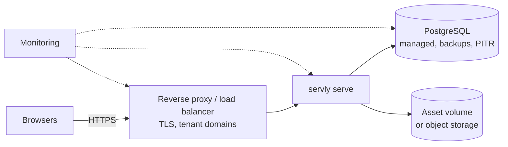

The managed cloud runs the same binary as the local deployment, with PostgreSQL. Many restaurants (tenants) share one deployment, or a tenant gets a dedicated deployment. This page describes the target architecture. Building it is Phase 6, after the local MVP is proven (MASTER_PLAN.md §15).

## Shape



* **One servly instance per deployment** in the MVP. SSE uses an in-process broadcaster, so a second instance would miss order events published by the first. Scaling out first needs an ADR for cross-instance notification, such as PostgreSQL `LISTEN/NOTIFY`.
* **PostgreSQL** with automated backups and point-in-time recovery. servly connects with a role that owns its schema. It needs no superuser.
* **Configuration** comes from environment variables:

  ```bash
  SERVLY_DATABASE_DRIVER=postgres
  SERVLY_DATABASE_URL=postgres://servly:…@db:5432/servly?sslmode=verify-full
  SERVLY_MIGRATE_ON_START=false   # run `servly migrate up` as a release step
  SERVLY_LOG_FORMAT=json
  ```

## Profiles

| | Shared (B) | Dedicated (C) |
|---|---|---|
| Tenants per deployment | many | one or a few |
| Database | shared PostgreSQL, tenant-scoped rows | own database |
| Isolation | application + schema FKs (+ RLS, planned) | separate processes and databases as well |
| Artifact | same image | same image |

## TLS and domains

* TLS terminates at the proxy. servly sees HTTPS through `X-Forwarded-Proto` from a trusted proxy only, and then marks cookies `Secure`.
* Each tenant may have hostnames in `tenant_domains`, such as `roma.servly.app`. A hostname selects which tenant's pages to show. It never authorizes anything.
* QR codes encode `https://<tenant host>/m/<token>`.

## Migrations and upgrades

1. Back up, or confirm that PITR covers the moment just before the upgrade.
2. Run `servly migrate up` once, as a release job. A PostgreSQL advisory lock stops concurrent runs.
3. Roll out the new image, and watch `/readyz`.
4. Rollback means rolling back the image while the schema stays compatible. Migrations stay additive within a release, and destructive changes come one release later.

## Operations

* **Monitoring:** `/healthz` (liveness), `/readyz` (readiness), JSON logs with `request_id`, and PostgreSQL metrics.
* **Resource limits:** set memory and CPU limits on the container. Public endpoints are rate-limited in the process, and the proxy should add a coarse per-IP limit.
* **Operational access:** production database access is limited to named operators. Platform admin actions on tenant data are audited (`audit_events`).
* **Tenant lifecycle:** provisioning and suspension are platform-admin actions. Today, `servly tenant create` provisions a tenant and its owner. The owner then works only in the browser ([ADR 0006](adr/0006-cli-scope.md)). Suspension blocks staff sign-in and public ordering and keeps the data. Automated provisioning and billing are out of scope until the operational model is proven.

## Tenant-specific backup and recovery

A shared database is backed up as a whole. Restoring one tenant means extracting that tenant's rows (every table has `tenant_id`) from a restored copy into production. The procedure is documented and rehearsed in Phase 6. A tenant that needs independent restores gets a dedicated deployment.
