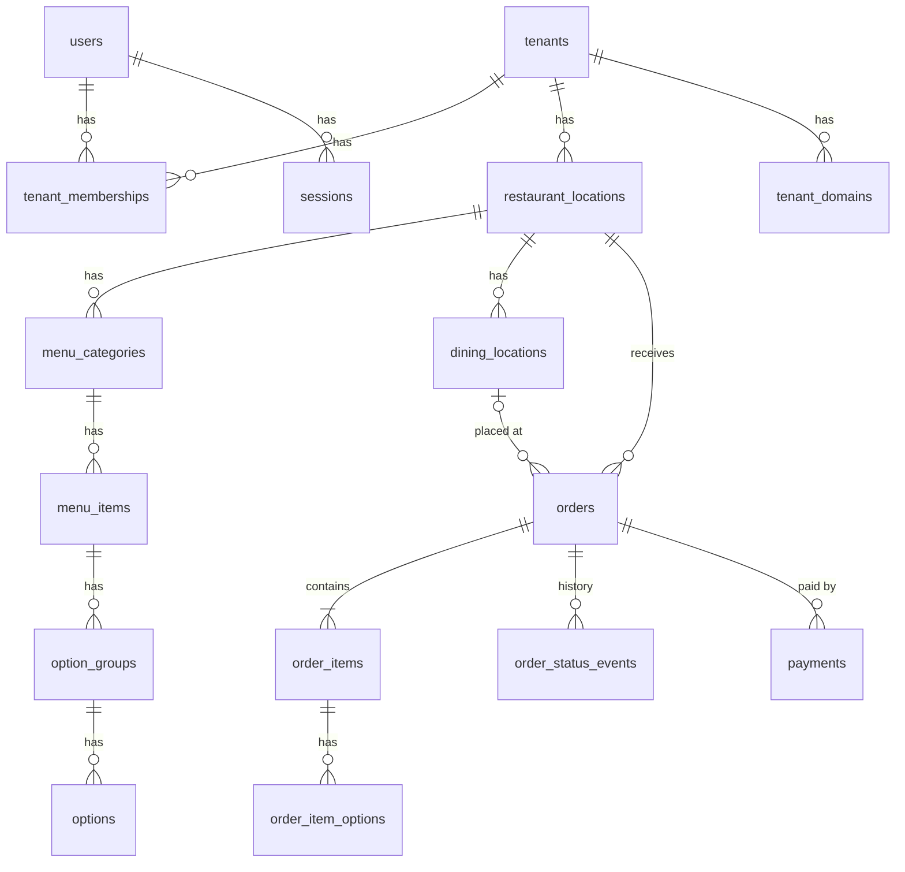
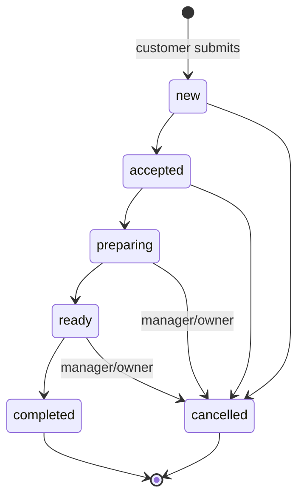
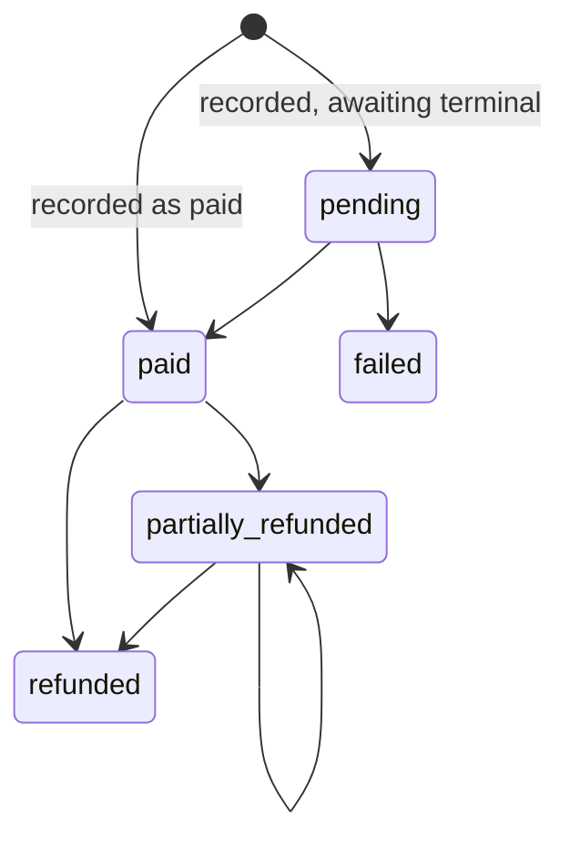

This page is the contract for entities, the schema, the order and payment lifecycles, and pricing. The executable form of the contract:

* schema: `migrations/sqlite/00001_initial_schema.sql`, `migrations/postgres/00001_initial_schema.sql`
* types and repository interfaces: `internal/{tenant,menu,orders,payments}`
* state machines: `orders.ValidateTransition`, `payments.ValidateTransition`, `payments.Summarize`

A change to any of these is a contract change (MASTER_PLAN.md §14.3). It needs a migration, an update to this page, and an ADR where §18 requires one.

## Entities

| Table | What it holds | Tenant-owned |
|---|---|---|
| `tenants` | the business account; `slug` unique; `status` active / suspended | is the tenant |
| `users` | staff and platform logins; global; `email` unique and lowercased; `is_platform_admin` | no |
| `tenant_memberships` | user × tenant with `role` owner / manager / staff; unique per pair | yes |
| `restaurant_locations` | a physical restaurant: `currency`, IANA `timezone`, feature flags; MVP: one per tenant | yes |
| `tenant_domains` | public hostname → tenant (optionally location); a routing hint only | yes |
| `sessions` | server-side staff sessions: SHA-256 of the token, active tenant, CSRF token, expiry | via user |
| `assets` | uploaded images: storage key, type, size, hash | yes |
| `menu_categories` | named, ordered, enable/disable | yes |
| `menu_items` | name, description, `price_minor`, image, `is_enabled` (admin), `is_available` (sold out), `archived_at` | yes |
| `option_groups` | per item: `min_select`, `max_select` | yes |
| `options` | per group: `price_delta_minor` (may be negative), `is_available` | yes |
| `dining_locations` | a table or pickup point; `public_token` in its QR code | yes |
| `order_number_counters` | last order number per location and business date | yes |
| `orders` | the order header and totals; snapshots | yes |
| `order_items` | lines; name and prices snapshotted | yes |
| `order_item_options` | chosen options; names and deltas snapshotted | yes |
| `order_status_events` | every status change: from, to, actor, reason, time | yes |
| `payments` | recorded payments: method, status, amount, refunded, reference | yes |
| `audit_events` | privileged and manual changes: actor, action, entity, JSON data | yes (nullable for platform events) |
| `idempotency_records` | (tenant, scope, key) → created order and request hash | yes |

## Invariants

1. Ids are UUIDv7, generated by the application (`ids.New`).
2. Money is integer minor units. Every amount has an explicit currency, which comes from the location.
3. Prices are entered tax-inclusive. The MVP only adds and multiplies, so no rounding occurs. A future feature that divides must round half to even at line level and document it in `internal/money`.
4. `order_number` is unique per `(tenant, location, business_date)` and starts at 1 each day. `business_date` is the order's creation date in the location's timezone (`orders.BusinessDate`).
5. Order lines keep name, unit price, option names and option deltas as they were at submission. Menu edits never change a past order.
6. An order, its lines, options, its first status event and its idempotency record commit in one transaction.
7. Every tenant-owned query is scoped by `tenant_id`. Composite foreign keys make cross-tenant references impossible in the schema itself.
8. Replaying an `Idempotency-Key` returns the original order and never creates a second one.
9. Completed and cancelled orders, their payments and their events are never deleted. A menu item that an order references is archived (`archived_at`) instead of deleted.
10. `orders.version` increases with every change to the order. A status change states the version it expects.

## Pricing

The server computes every price at submission from the current menu. The client sends only ids, quantities and notes.

For each line:

1. The item exists in this tenant and location, and `Orderable()` is true (enabled, available, not archived). Its category is enabled.
2. `1 ≤ quantity ≤ 99`. An order has at most 50 lines. Notes are at most 500 characters and are accepted only when the location enables them.
3. Every chosen option belongs to one of the item's groups and is available. Within each group, `min_select ≤ chosen ≤ max_select`, and no option is chosen twice.
4. `options_total = Σ price_delta` of the chosen options.
5. `unit = price + options_total`. Reject the line if `unit < 0`.
6. `line_total = unit × quantity`, computed with `money.Mul`, which checks for overflow.

Then `subtotal = Σ line_total`, and `total = subtotal`. There are no fees, taxes or discounts in the MVP. Every addition uses `money.Add`.

## Order lifecycle

* Only the one forward path exists: no skipping, no going back. `completed` and `cancelled` are final.
* Staff may cancel `new` and `accepted` orders. Cancelling an order whose preparation has begun (`preparing`, `ready`) requires `orders.cancel_started`, which managers and owners have.
* Every cancellation requires a reason.
* **Correction workflow:** an order's contents are never edited. Staff cancel it with a reason and place a new one.
* Each change writes `order_status_events` (from, to, actor, reason, time) and increments `version`. The update is `UPDATE … WHERE id = $1 AND tenant_id = $2 AND version = $3`. When zero rows match, the result is `order_conflict` (409), and the client refetches.
* The event is published to SSE only after the transaction commits.
* Order status and payment status are independent. An order can complete unpaid, and a payment can be recorded before the order is ready.

## Payment lifecycle

A payment records money taken outside servly: cash, an external card terminal, or something else. servly does not verify a terminal transaction. A recorded payment is a staff statement and is audited as one. Card numbers, security codes and similar data are never accepted or stored.

* **MVP rule:** a new payment's amount equals the order's outstanding amount (`payments.Outstanding`). Split and partial payments are out of scope.
* A refund (`Payment.Refund`) needs `payments.refund`, which managers and owners have. The amount is positive and at most the unrefunded amount. Refunding the remainder moves the payment to `refunded`.
* `orders.payment_status` is derived by `payments.Summarize` and stored on the order after each payment change. The rules, checked in order:
  1. Any refund recorded: `refunded` if nothing net remains, else `partially_refunded`.
  2. Paid payments cover the total: `paid`. An order with total 0 is `paid`.
  3. A payment is pending: `pending`.
  4. Otherwise (no payments, or all failed): `unpaid`.
* Each payment change writes an `audit_events` row.

## Roles and permissions

| Permission | staff | manager | owner |
|---|:-:|:-:|:-:|
| `orders.view` | ✓ | ✓ | ✓ |
| `orders.update_status` | ✓ | ✓ | ✓ |
| `payments.record` | ✓ | ✓ | ✓ |
| `orders.cancel_started` |  | ✓ | ✓ |
| `payments.refund` |  | ✓ | ✓ |
| `menu.manage` |  | ✓ | ✓ |
| `dining_locations.manage` |  | ✓ | ✓ |
| `staff.manage` |  |  | ✓ |
| `settings.manage` |  |  | ✓ |

Platform administration is the `users.is_platform_admin` flag, not a role. It grants tenant provisioning, not access to a tenant's data. See [Security](security.md#authorization).

## Idempotent order creation

`POST /api/public/orders` requires an `Idempotency-Key` header: 8 to 128 characters of `[A-Za-z0-9_-]`. The client generates one per checkout (a UUID) and reuses it on every retry. In the creating transaction, the server does this:

1. Resolve the dining location from the token. This determines the tenant.
2. Hash the canonical request: the SHA-256 of the decoded body, re-encoded as JSON with sorted keys.
3. Look up `(tenant, "public_order_create", key)`.
   * The key exists with the same hash: return the stored order with `200` instead of `201`.
   * The key exists with a different hash: `idempotency_key_reused` (409).
4. Otherwise price the order, allocate the number, insert the order, then insert the record (`expires_at` = now + 24 h).

The primary key on `idempotency_records` makes two concurrent first submissions safe. One commits, and the other fails the insert, rolls back and retries from step 3.
