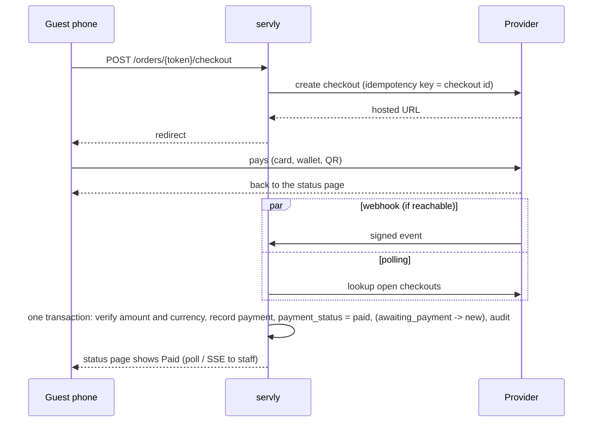

**Status:** planned (MASTER_PLAN.md Phase 7, [ADR 0007](adr/0007-online-payments.md)). Today servly records payments by hand: cash, an external card terminal, or other. This page is the design for taking payments through payment providers.

servly does not process cards itself, and it does not invent a payment flow. Every provider below already solves card security, Strong Customer Authentication, local wallets and payouts. servly connects to them through a small adapter and follows their recommended integration. It also keeps the rule it has today: **the server, not the guest's browser, decides when an order is paid.**

## Principles

1. **Hosted first.** Guests pay on the provider's hosted checkout page or QR code. Card data never reaches servly, which keeps it at the lightest PCI DSS level (SAQ A). Apple Pay and Google Pay work on hosted pages without servly verifying a domain, so they also work on a local install.
2. **The provider's word, checked twice.** A payment counts only when servly reads it from the provider's API or a signed webhook, and the amount and currency match the order. A guest returning from checkout proves nothing.
3. **Polling always works, webhooks speed it up.** A local install usually has no public address for webhooks. servly therefore polls open payments until they settle or expire. Where a public HTTPS address exists, webhooks make the result immediate. Both paths run the same idempotent update.
4. **One adapter per provider, not per payment method.** Cards, wallets and QR codes are options inside a provider. Adding PayNow does not mean new code once the provider supports it.
5. **Ubiquity decides the order of work.** In each market, the methods most guests use come first: national QR codes in Southeast Asia, and cards with Apple Pay and Google Pay in Europe and the US.
6. **Manual payments stay.** Cash, an unconnected card terminal and "other" keep working, also when the internet is down.

## Markets: what guests pay with

The ranking is what a restaurant in that market should switch on first. "Everyday" means most guests can pay this way. "Common" means a large minority use it. The provider columns name who supports it.

### Indonesia (IDR)

| Rank | Method | Use | Providers |
|---|---|---|---|
| 1 | **QRIS**: the national QR standard of Bank Indonesia | everyday. One dynamic QR code is payable by every e-wallet (GoPay, OVO, DANA, ShopeePay, LinkAja) and every banking app | Xendit, Midtrans |
| 2 | E-wallets directly (GoPay, OVO, DANA, ShopeePay) | everyday on phones: the guest's app opens with the amount filled in | Xendit, Midtrans |
| 3 | Bank virtual accounts (BCA, BRI, Mandiri, BNI) | common for larger amounts; slow for a restaurant | Xendit, Midtrans |
| 4 | Cards | common in tourist areas | Xendit, Midtrans |

Stripe is only in preview in Indonesia, so it is not the recommended provider there. **Recommended: Xendit.** It covers QRIS and the wallets, and also Malaysia, the Philippines, Thailand and Vietnam with the same adapter. Midtrans (GoTo group, native GoPay) is the alternative.

### Singapore (SGD)

| Rank | Method | Use | Providers |
|---|---|---|---|
| 1 | Cards with **Apple Pay and Google Pay** | everyday | Stripe, HitPay, Adyen |
| 2 | **PayNow** (SGQR) | everyday; every banking app | Stripe, HitPay |
| 3 | GrabPay | common | Stripe, HitPay |
| 4 | NETS (in person) | common at counters | through terminals |

**Recommended: Stripe**, which offers cards, wallets, PayNow and GrabPay, its own card readers, and Tap to Pay. **HitPay** is the small-business alternative and is strong on QR codes and terminals.

### Malaysia (MYR)

| Rank | Method | Use | Providers |
|---|---|---|---|
| 1 | **DuitNow QR**: the national QR standard | everyday; every banking app and e-wallet | HitPay, Fiuu, Xendit |
| 2 | E-wallets: Touch 'n Go, GrabPay, ShopeePay, Boost | everyday among younger guests | HitPay, Fiuu (GrabPay also Stripe) |
| 3 | Cards with Apple Pay and Google Pay | common | all |
| 4 | FPX (online banking) | common online, rare at a table | Stripe, HitPay, Fiuu, Xendit |

Stripe has no DuitNow QR. **Recommended: HitPay**, which covers DuitNow QR, FPX, the wallets and cards, and also Singapore. Stripe is the alternative for restaurants that mostly see cards.

### European Union (EUR and local currencies)

| Rank | Method | Use | Providers |
|---|---|---|---|
| 1 | Cards (Visa, Mastercard, and co-badged national cards) with **Apple Pay and Google Pay** | everyday | Stripe, Mollie, Adyen, SumUp |
| 2 | Country methods: **iDEAL / Wero** (NL), Bancontact (BE), BLIK (PL), EPS (AT), Przelewy24 (PL) | everyday in their country | Stripe, Mollie, Adyen |
| 3 | **PayPal** | common, especially DE | Stripe (merchants with their own Stripe account, EEA, UK and CH), Mollie, PayPal directly |
| 4 | Klarna | common online, rare in restaurants | Stripe, Mollie, Adyen |

iDEAL is moving to Wero: co-branding during 2026, with iDEAL expected to shut down in 2027–28. The provider handles the change, so the adapter keeps the method ID and shows the provider's current name. **Recommended: Stripe.** **Mollie** suits Dutch, Belgian and German small businesses. **SumUp** is the most common card reader in small European restaurants, and its Cloud API lets a web app start a payment on the reader.

### United States (USD)

| Rank | Method | Use | Providers |
|---|---|---|---|
| 1 | Cards with **Apple Pay and Google Pay** | everyday | Stripe, Square, Adyen |
| 2 | **Tips** at payment | expected | the checkout, not a method |
| 3 | PayPal and Venmo | common | PayPal directly, Braintree |
| 4 | Cash App Pay | common among younger guests | Stripe, Square |

**Recommended: Stripe.** **Square** is widespread in US restaurants and has its own terminal API.

### Global brands

* **Visa and Mastercard** come with every provider. American Express, JCB and UnionPay depend on the provider and the merchant's contract; the provider reports which brands it accepts.
* **Apple Pay and Google Pay** need no extra setup on hosted checkout pages. Embedded checkout on servly's own pages would need domain verification and HTTPS, which is why servly uses hosted pages first.
* **PayPal** goes through Stripe or Mollie where they offer it. Elsewhere, and for platform accounts, it needs its own adapter (Phase 7.5).

## Providers and the order of work

| Order | Adapter | Why first | Covers |
|---|---|---|---|
| 1 | **Stripe** | widest coverage of cards and wallets; server-driven card readers; Tap to Pay SDK | EU, US, SG, MY (cards, FPX, GrabPay) |
| 2 | **Xendit** | QRIS and Indonesian wallets; one adapter for several SEA markets | ID, MY, PH, TH, VN |
| 3 | **HitPay** | DuitNow QR and PayNow for small restaurants; terminals | SG, MY |
| 4 | **PayPal** (direct) | PayPal and Venmo where Stripe cannot offer them, and for platform accounts | global, US Venmo |
| later | Mollie, Adyen, Midtrans, Square, SumUp, Fiuu | when restaurants ask for them | – |

Stripe and Xendit together cover the top-ranked method in all four regions, except DuitNow QR, which HitPay adds.

## Connecting a provider

A restaurant connects its **own** provider account. The restaurant is the merchant: payouts go to its bank, and it handles its own disputes. servly never holds the money.

There are two ways to connect, chosen by the deployment, not by the restaurant:

| Mode | Where | How |
|---|---|---|
| **Own keys** | self-hosted (default) | The owner creates a restricted API key in the provider's dashboard and pastes it into the wizard. servly checks it right away (a read-only "who am I" call) and shows the account name, country and currency. |
| **Platform connect** | managed cloud | servly is registered with the provider as a platform: Stripe Connect with Standard accounts and hosted onboarding (Account Links, not the legacy OAuth flow), Xendit xenPlatform, PayPal partner onboarding. The owner clicks "Connect", signs in or signs up at the provider, and comes back. No keys are copied. |

Platform connect needs platform credentials that only an operator holds. They are configured in the environment, so a self-hosted install offers "own keys" only. Caveat: PayPal through Stripe is not available to software platforms, so a managed cloud offers PayPal through the PayPal adapter.

### The setup wizard

Settings → **Payments** → **Set up online payments**. It follows the same pattern as the first-run setup: one decision per step, and resuming where it stopped.

1. **Where you trade.** The country, suggested from the restaurant's currency and timezone. It decides which providers and methods the next step offers.
2. **Choose a provider.** Provider cards in the ranked order for that country, with the recommended one first. Each card lists the methods guests there use most, its card readers, and a link to its pricing. servly does not compare fees; providers change them.
3. **Connect.** "Connect with Stripe" (platform) or the own-keys form, with a link to the right page of the provider's dashboard and a screenshot of where the key is. Test mode comes first: test keys, or the provider's sandbox.
4. **Payment methods.** Switches for the methods the connected account can actually accept, read from the provider. Each has a one-line explanation, such as "QRIS: every Indonesian e-wallet and banking app can pay it". Recommended methods are switched on.
5. **When guests pay.** Separately for tables and pickup points:
   * **Tables:** *pay from the phone when finished* (default), *pay when ordering*, or *staff only*.
   * **Pickup points:** *pay when ordering* (default once online payments work), *pay at the counter*, or *either*.
   * **Tips** where the locale expects them: off by default, preset percentages.
6. **In person (optional).** Pair a card reader with its registration code, and switch on "show a payment QR on the staff screen" for QRIS, PayNow or DuitNow.
7. **Test, then go live.** A test order is paid on the owner's phone with test credentials. The go-live checklist covers:
   * live keys or a live account;
   * the currency matching the restaurant;
   * a public address, or the note that webhooks are off and polling is used;
   * the return address the guest lands on.

The wizard stores progress on the server, so closing the browser does not lose a connected account. Disconnecting is one action and keeps every past payment record.

## Guest flows

### Pay when finished (tables)

The order is sent as today. The order status page shows **Pay now · €24.50**:

1. The guest opens it and picks a method.
2. The provider's hosted page or QR code takes the payment.
3. The guest returns to the status page, which shows "Paid".
4. The staff board's **To pay** view clears without staff doing anything.

### Pay when ordering (pickup, or tables if chosen)

1. The cart's button becomes **Pay and order · €24.50**.
2. The order is created as **awaiting payment**. The kitchen does not see it yet.
3. The guest pays on the hosted page.
4. Once the payment is confirmed, the order becomes **new** and appears on the board.
5. An unpaid order expires after 15 minutes (configurable) and is cancelled with the reason "payment not completed". Retries use the same idempotency key, so a guest who pays twice is caught by the reconciler and refunded automatically.

This adds one state to the order lifecycle: `awaiting_payment → new`, or `awaiting_payment → cancelled`. ADR 0007 records it.

### QR methods on a phone

A guest cannot scan a QR code shown on the phone they are holding. On phones, the adapter therefore prefers the provider's app-switch flow: open GoPay, DANA, the banking app, and so on, with the amount filled in. It shows the QR code only on larger screens, or when the guest asks for it.

### Language

The hosted page gets the guest's language (`id`, `ms`, `zh`, `en`, `de`, …) where the provider supports it. servly's own texts follow the same language once the web app is translated (outside this plan).

## Staff flows

The order panel's **Record payment** gains two ways to pay next to cash, terminal and other:

* **Charge on reader**: servly sends the amount to a paired card reader and the result arrives on its own. This is the server-driven integration, so the web app needs no SDK: Stripe smart readers (WisePOS E, S700), SumUp Solo (Cloud API), and later Square Terminal and Adyen terminals.
* **Show payment QR**: a dynamic QRIS, PayNow or DuitNow code for the exact amount, on the staff tablet or the pickup screen. The guest scans it with their own phone. It is marked paid when the provider confirms.

Other staff changes:

* **Refunds** of online and reader payments go through the provider, from the same panel and with the same permission (`payments.refund`). Cash refunds stay manual.
* **Tap to Pay on iPhone and Android** turns the staff phone into the card reader. It always needs a native app built with the provider's SDK, and an Apple entitlement on iPhone. The web app cannot do it. It is planned as a small "servly Counter" app in Phase 7.6, which needs its own decision record, because native apps are out of the MVP's scope. Until then, staff using a provider's own Tap to Pay app record the payment as "Card terminal", as they do today.

## Architecture

### Adapter

The contract lives in `internal/payments/provider`, and each provider is its own package (`provider/stripe`, `provider/xendit`, …). An adapter only translates: business rules, idempotency and state changes stay in `internal/app`.

```go
type Provider interface {
	ID() string // "stripe", "xendit", ...
	// Verify checks credentials and returns the account's identity, country,
	// default currency and the methods it can accept.
	Verify(ctx context.Context, c Credentials) (*Account, error)
	// CreateCheckout starts a hosted payment for one amount. The key makes
	// retries return the same checkout.
	CreateCheckout(ctx context.Context, c Credentials, in CheckoutInput, idempotencyKey string) (*Checkout, error)
	// Lookup reads the authoritative state of a checkout (the polling path).
	Lookup(ctx context.Context, c Credentials, providerRef string) (*Result, error)
	// ParseWebhook verifies the signature and timestamp, then returns the
	// event; an unverifiable request returns ErrBadSignature.
	ParseWebhook(c Credentials, header http.Header, body []byte) (*Event, error)
	Refund(ctx context.Context, c Credentials, providerRef string, amount money.Amount, idempotencyKey string) (*Refund, error)
}

// Optional capabilities, discovered by type assertion.
type ReaderProvider interface { /* pair, list, charge, cancel on a server-driven reader */ }
type QRProvider interface { /* create a dynamic QR for an amount, for in-person display */ }
type PlatformProvider interface { /* hosted onboarding links for platform connect */ }
```

Each adapter owns its money conversion. servly stores ISO 4217 minor units. Some providers count differently: Xendit takes whole rupiah, while ISO gives IDR two decimals. The conversion is unit-tested per adapter and per currency, and it rejects amounts it cannot represent exactly.

### Data model (additions)

| Table | Holds |
|---|---|
| `payment_accounts` | per tenant and location: provider, mode (test/live), connection (own keys / platform), provider account ID, country, currency, enabled methods, guest-flow settings, **encrypted** credentials, status |
| `payment_checkouts` | one hosted payment attempt: order, account, amount, currency, provider reference, status (`open`, `paid`, `failed`, `expired`, `cancelled`), expiry, idempotency key |
| `payment_events` | every provider event received: provider, provider event ID (unique), signature result, received and processed times. Used for deduplication and audit |
| `payment_readers` | paired card readers: provider, reader ID, label |

The existing `payments` table gains `provider`, `provider_ref`, `checkout_id` and a display detail (such as "Visa •••• 4242" or "QRIS · DANA"). It never holds card numbers or security codes. Order-level `payment_status` keeps its meaning and its values.

### API (additions)

| Endpoint | Who |
|---|---|
| `GET /api/admin/payments/catalog?country=SG` | providers and methods ranked for a country (static, versioned with the app) |
| `POST /api/admin/payment-accounts` | connect: verify own keys, or start platform onboarding (returns the provider URL) |
| `GET`, `PATCH`, `DELETE /api/admin/payment-accounts/{id}` | settings, methods, guest flows; disconnect |
| `POST /api/admin/payment-accounts/{id}/test` | run a test checkout |
| `POST /api/admin/orders/{id}/payments/reader` | charge on a paired reader |
| `POST /api/admin/orders/{id}/payments/qr` | dynamic QR for in-person payment |
| `POST /api/public/orders/{orderToken}/checkout` | the guest starts paying; returns a hosted URL or app-switch link |
| `POST /api/payments/webhooks/{provider}/{accountId}` | provider webhooks; public and signature-checked |

Permissions: connecting and settings need `settings.manage` (owner). Charging, the QR code and reader payments need `payments.record`. Refunds need `payments.refund`.

### Settling a payment



The **reconciler** is a goroutine like today's maintenance loop. It looks up open checkouts with backoff (10 s, then up to 2 min), stops at their expiry, and catches up after a restart. It runs per process and claims work with a row lock or a status update, so two instances never apply the same result twice. Webhook and reconciler share one function, which is idempotent by `(provider, provider_ref, status)`.

### Local installs

A self-hosted servly needs internet for online payments, and the guest's phone needs it too. When the provider is unreachable:
- the guest sees online payment as unavailable and pays staff instead;
- the board keeps working;
- open checkouts are reconciled when the connection returns.

The return address after checkout is servly's own address, so it must be reachable by the guest's phone (`http.public_base_url`). Some providers require HTTPS return addresses in live mode. The adapter checks this when connecting, and the wizard explains it: put servly behind HTTPS, or let the guest come back through the provider's "done" page and the status link.

## Security and compliance

* **PCI DSS:** hosted pages and server-driven readers keep servly out of card data (SAQ A). servly never accepts, logs or stores card numbers or security codes. The existing check that rejects references that look like card numbers stays.
* **Credentials** are encrypted at rest with AES-256-GCM. The key comes from `SERVLY_SECRET_KEY`, and a key ID allows rotation. Without a key, the payments wizard is disabled and says why. Credentials are write-only in the UI and API (shown as `sk_live_…7Qx`), never logged, and never included in exports. Restricted keys with the fewest permissions are what the wizard asks for.
* **Webhooks:** the signature is verified with the provider's scheme, timestamps outside the provider's tolerance are rejected, the event ID is deduplicated, and the amount and currency are checked against the order. The endpoint is rate-limited and size-limited.
* **Authentication and Strong Customer Authentication** (PSD2 in the EU, and the equivalents elsewhere) are handled by the provider's hosted page.
* **Tenant isolation:** every account, checkout and event is tenant-scoped. The webhook path names the account, and the event must match that account's credentials.
* **Audit:** connect, disconnect, method changes, live switch, refunds and reader pairing write `audit_events`.
* **Data protection:** GDPR (EU), PDPA (SG, MY) and UU PDP (ID). servly stores only what reconciliation needs. Guest identity stays with the provider.
* **Fiscal rules are not solved by payments.** Germany's KassenSichV with a TSE, Austria's RKSV, Italy's and France's rules, and Indonesian e-invoicing apply to the restaurant's till. servly stays an order system; this plan does not make it a cash register (MASTER_PLAN.md §8).

## Before going live in each market: charges and taxes

A payment must charge exactly what the guest saw. Today, menu prices are final amounts. Several markets add charges at the bill:
- **Singapore:** a 10% service charge, then GST.
- **Malaysia:** a service charge, plus service tax on food and drink.
- **Indonesia:** a service charge, plus the regional restaurant tax (PB1, now PBJT).
- **US:** sales tax, plus tips.

Online payment in those markets therefore depends on a small **order charges** feature: percentage charges per location, shown on the menu, cart and receipt, and stored on the order like its other price snapshots. MASTER_PLAN.md Phase 7 lists it as step 7.0, before the first SEA or US launch. The EU, where menu prices include VAT, can launch without it.

## Open questions

* Should guests be able to split a table's bill? Probably later, by item or by amount, through one checkout per share.
* Should guests get receipts by email? Providers can send them, which keeps guest email addresses out of servly.
* Should the platform keep an application fee per payment? No: subscription billing is out of scope (MASTER_PLAN.md §2.2) until the operational model is proven.
